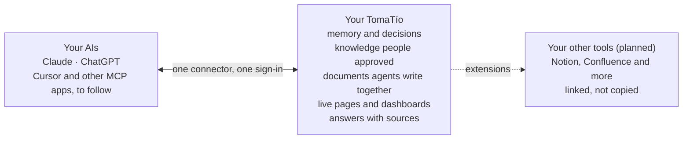

<p align="center">
  <a href="https://tomatio.ai"></a>
</p>

<p align="center">
  <a href="https://tomatio.ai"><strong>tomatio.ai</strong></a> · <a href="https://tomatio.ai/why">Why TomaTío</a> · <a href="https://tomatio.ai/compare">Compare</a> · <a href="https://tomatio.ai/roadmap">Roadmap</a> · <a href="https://tomatio.ai/docs">Docs</a> · <a href="https://tomatio.ai/self-host">Run it yourself</a>
</p>

<p align="center">
  <a href="https://github.com/tomatio-ai/tomatio/releases/latest"></a>
  <a href="https://www.gnu.org/licenses/old-licenses/gpl-2.0.html"></a>
  <a href="https://tomatio.ai/docs/install"></a>
  <a href="https://tomatio.ai/docs/install"></a>
  <a href="https://tomatio.ai/docs/connect-an-ai"></a>
  <a href="https://tomatio.ai/docs/connect-an-ai"></a>
  <a href="https://modelcontextprotocol.io"></a>
  <a href="https://github.com/pcp-protocol/pcp"></a>
</p>

<p align="center">
  <sub>TomaTío, from the Spanish «¡toma, tío!», roughly “take that, dude”.</sub>
</p>

**One context for you, your team and every AI you use.** Memory, decisions, documents and live pages that Claude, ChatGPT and your other AI apps share, on your phone, the web and your computer, kept where you choose.

Claude and ChatGPT today, more AI apps to follow · People approve what agents write · Runs on any WordPress hosting · Export everything in an open format

> [!NOTE]
> Free and open source under the GPL. Every feature is in the plugin: no paid tier, no licence key, no analytics. You pay only for wherever you run it, which can be the hosting you already have.

## Start with yourself, _or start with your team_.

| For you | For your team |
| --- | --- |
| **Your context, in a TomaTío of your own.** What your AI apps learn about you, kept in one place you control, not in each app's cloud. Try a new AI app, and it knows you from day one. | **One brain for your people and their agents.** Every AI starts from the same briefing, and people approve what becomes team knowledge. |
| **A WordPress site on a hosting plan.** Most hosts make one in a click, and the free plugin turns it into your TomaTío. | **Agencies and consultancies.** A scope per client. Each client's agents see only that client's work. |
| **Every AI app, everywhere.** Connect Claude and ChatGPT once, and reach it from your phone, the web and your computer. | **Teams on more than one AI.** Claude and ChatGPT start from the same briefing. Nobody explains the project twice. |
| **Others, when you want.** Invite people, or give an always-on agent its own sign-in and scope. | **Teams that must own their data.** It lives in your own database, and every memory shows its source and who approved it. |

## Try it first

Neither is a detour. What you start on your computer moves whole to a hosting plan later, in the open Portable Context Protocol (PCP), so you never start over.

**Ask the docs brain.** Connect your AI to a read-only TomaTío and ask Claude or ChatGPT how TomaTío works: it answers from the docs brain with sources. It holds nothing of yours, so keep it connected after you're set up, for help. [Connect the docs brain ↗](https://tomatio.ai/self-host#help)

**Run it on your computer.** Your TomaTío in about a minute. Free, no account, and nothing leaves it.

```sh
curl -fsSL https://tomatio.ai/install-local | bash
```

```powershell
irm https://tomatio.ai/install-local.ps1 | iex
```

It connects every AI app it finds (Claude Desktop, Claude Code, Codex, Cursor, Windsurf). It needs Node 20 or newer and offers to install Node 24 just for TomaTío. On Claude Desktop alone, [one download](https://tomatio.ai/install-local/claude-desktop) does it. The installer sends an anonymous install count; set `TOMATIO_NO_TELEMETRY=1` to skip it. [Install on your own computer ↗](https://tomatio.ai/docs/install-locally)

## Up and running _in minutes_.

### 01 · Start a TomaTío

Install the free plugin on a WordPress site of its own (WordPress 7.1 or newer, PHP 8.3 or newer, HTTPS), on a hosting plan, or ask for a hosted team brain.

```sh
curl -LOJ https://tomatio.ai/download
curl -LOJ https://tomatio.ai/download.sha256
shasum -a 256 -c tomatio-*.zip.sha256
wp plugin install tomatio-*.zip --activate
```

No WP-CLI? Upload the zip in **Plugins > Add New Plugin > Upload Plugin**. Use the release zip, not GitHub's "Download ZIP" button: that copy will not run. Updates arrive through the built-in updater, checked against their checksum. [Install ↗](https://tomatio.ai/docs/install)

### 02 · Connect your AI

Open **TomaTío > Connect an AI** and add the connector address in Claude or ChatGPT. Sign in once with OAuth. [Connect an AI ↗](https://tomatio.ai/docs/connect-an-ai)

### 03 · Keep it, or share it

Your AIs remember and brief each other. Once others join, people review and approve.

## More than memory. _One connector for everything your AIs need to know_.



**You → a project → a team → your company.** One TomaTío grows with you, and scopes keep each part apart.

## What's in the box, _numbered_.

### 01 · One briefing for every AI

Each AI starts a session with a short briefing, about 2,000 tokens unless you change it, and searches for anything more only when it needs it. The brain is never loaded whole into a chat.

### 02 · Memory that keeps its sources

TomaTío saves only what a connected AI writes to it; it doesn't read your chats. Your AI saves a note when you ask ("remember that the client moved the launch to March"), and some AIs also save on their own when something looks worth keeping. Every note shows who saved it, from which tool and when. _[Memory ↗](https://tomatio.ai/docs/memory)_

### 03 · People approve what counts

Agents suggest knowledge; nothing becomes shared team knowledge until a person approves it in the review queue. Procedures, the team's playbooks, are written by people. _[The review queue ↗](https://tomatio.ai/docs/review-queue)_

### 04 · Scopes, not one big bucket

Everything lives in scopes, such as one team, one client or one person's private notes, and each agent reads only the scopes you give it, so a contractor's agent never sees the rest. _[Agents, people and scopes ↗](https://tomatio.ai/docs/agents-and-scopes)_

### 05 · Every AI signs in as itself

One connector address, added like any other, and a consent screen. Each AI connects as its own agent; cut it off at any time, and everything it does is in the audit log. _[Delegated authority ↗](https://tomatio.ai/docs/delegated-authority)_

### 06 · Documents agents write together

Plans, briefs, reports and roadmaps that people and agents write together, approved section by section, with every version kept. A finished document becomes a WordPress draft post. _[Documents ↗](https://tomatio.ai/docs/documents)_

### 07 · Live pages and dashboards

Pages and dashboards that read the brain's own data, and pages that remember: a poll, a sign-up sheet, a checklist. Server-enforced rules decide who may write what, and every write is kept for 30 days, so you can undo everything a leaked link wrote. _[HTML pages ↗](https://tomatio.ai/docs/html-pages)_

### 08 · Share by link

Share any document or page publicly, privately or for members, with every version kept. _[Sharing ↗](https://tomatio.ai/docs/sharing)_

### 09 · Answers with sources

Ask a question and the answer cites the memories and knowledge it came from.

### 10 · Export everything, in an open format

The whole brain exports in the open Portable Context Protocol (PCP): memories, knowledge and decisions with their history, people, agents and scopes, documents and pages, the audit log. Import it anywhere; erase what you must, with a receipt that never contains what was erased. TomaTío is PCP's reference implementation. _[Export and migration ↗](https://tomatio.ai/docs/export-and-migration)_

```sh
wp tomatio export --output=/secure/place/brain.pcp.zip
```

### 11 · Runs on any WordPress hosting

A plugin under 2 MB. No Docker, no extra services. WordPress is proven and already everywhere, and it brings what TomaTío needs: users and roles for every person and agent, sign-in, revisions and an editor. _[Why WordPress ↗](https://tomatio.ai/why)_

### 12 · Your data stays where you put it

In your TomaTío's own WordPress database: on your laptop, your hosting, your server or your cloud. There is no central TomaTío service holding your memories. The brain runs no AI model, collects no analytics, and contacts no outside service you didn't switch on, apart from the update check.

## Already on Confluence or Notion?

Your agents can read a wiki. They can't work in one. A wiki holds finished pages; what agents learn while they work, why a decision was made, what was tried, what a client asked for, has nowhere to go except more pages nobody approved.

- **A place where agents work.** Each agent saves what it learns as it goes, under its own name and only in the scopes it may use. A person approves what becomes team knowledge, and every AI starts its next session briefed on it.
- **Keep your wiki** _(planned)_. Extensions will plug Notion and Confluence into the brain: agents cite their pages by link, read them live, and bring them in as dated reference kept apart from what your team approved. Linked, never copied or synced.
- **Or let the brain hold the pages.** Plans, briefs, reports and roadmaps written by people and agents together, approved section by section, shared by link.

Need rich, live co-editing? Notion and Confluence still do that better; it is on the [roadmap](https://tomatio.ai/roadmap).

## How it compares

Wikis are built for people. Agent memory is built for developers. TomaTío is built for both.

|                                | Team wikis<br><sub>Confluence, Notion</sub> | Agent memory<br><sub>Mem0, Zep</sub> | Built-in memory<br><sub>ChatGPT, Claude</sub> | **TomaTío** |
| ------------------------------ | :-----------------------------------------: | :----------------------------------: | :-------------------------------------------: | :---------: |
| People and agents share it     | ✓                                           | –                                    | ◐                                             | **✓**       |
| People approve agent writes    | ◐                                           | –                                    | –                                             | **✓**       |
| Runs on your own server        | –                                           | ✓                                    | –                                             | **✓**       |
| Moves in an open format        | –                                           | –                                    | –                                             | **✓**       |

✓ yes · ◐ partly or opt-in · – no. Checked on 29 October 2026 against each product's own docs. [See 29 options compared in detail ↗](https://tomatio.ai/compare)

## Questions

<details>
<summary><strong>Do I need a team?</strong></summary>

No. Set up a TomaTío just for you on a WordPress hosting plan: Claude, ChatGPT and your other AI apps share one memory, on your phone, the web and your computer, and it stays yours. Invite people only when you want to. If you'd rather keep everything on one computer, [run it locally](https://tomatio.ai/docs/install-locally).
</details>

<details>
<summary><strong>Is it free?</strong></summary>

Yes. It's free and open source (GPL). You pay only for wherever you run it, which can be the hosting you already have.
</details>

<details>
<summary><strong>How does it connect to my AI tools, and what can each one see?</strong></summary>

Through one connector address, added like any other: a custom connector in Claude or an app in ChatGPT's developer mode. Cursor, VS Code and other MCP apps connect the same way, but we haven't checked them yet. You sign in and approve it on a consent screen. Each AI connects as its own agent and reads and writes only the scopes you give it, such as one project or one client. You can cut an agent off at any time, and everything it does is in the audit log.
</details>

<details>
<summary><strong>Won't a shared brain use a lot of tokens?</strong></summary>

No. Each AI starts a session with a short briefing, about 2,000 tokens unless you change it, and searches for anything more only when it needs it. The brain is never loaded whole into a chat.
</details>

<details>
<summary><strong>Why does it matter who holds it?</strong></summary>

What an AI remembers is how you think, what you're working on and what you decided. Held by one company, it lives on that company's terms, and at most a summary comes with you when you leave. Kept on a server you choose, in an open format, it stays yours, whole. And when a better AI app comes along, you connect it and it knows you from day one.
</details>

<details>
<summary><strong>Where does my data live?</strong></summary>

In your TomaTío's own WordPress database: on your laptop, your hosting, your server or your cloud. There is no central TomaTío service holding your memories, and you can export everything any time in the open Portable Context Protocol (PCP).
</details>

More answers on [tomatio.ai](https://tomatio.ai) and in the [manual](https://tomatio.ai/docs).

## Documentation

| Start here                                                      | Run it                                                               | Go deeper                                                      |
| --------------------------------------------------------------- | -------------------------------------------------------------------- | -------------------------------------------------------------- |
| [What a brain does](https://tomatio.ai/docs/what-is-tomatio)    | [Install](https://tomatio.ai/docs/install)                           | [Memory](https://tomatio.ai/docs/memory)                       |
| [Connect an AI](https://tomatio.ai/docs/connect-an-ai)          | [Install locally](https://tomatio.ai/docs/install-locally)           | [Documents](https://tomatio.ai/docs/documents)                 |
| [For AIs](https://tomatio.ai/docs/for-ais)                      | [Settings](https://tomatio.ai/docs/settings)                         | [HTML pages](https://tomatio.ai/docs/html-pages)               |
| [How it compares](https://tomatio.ai/docs/how-tomatio-compares) | [Export and migration](https://tomatio.ai/docs/export-and-migration) | [What self-hosters can count on](https://tomatio.ai/self-host) |

## Who makes it

[Roger Gentry](https://github.com/jamesrascal) designed Agent Brain, the plugin TomaTío grew out of, and built its first version. [Dennis Kittrell](https://github.com/thefactremains) had the idea of building it on WordPress, leads the project, and has done most of the work since mid-October 2026.

## Contributing

Questions and bugs: open an issue. Code: start with [CONTRIBUTING.md](CONTRIBUTING.md). Security reports: see [SECURITY.md](SECURITY.md).

## Licence

TomaTío is licensed under the [GNU General Public License, version 2 or later](LICENSE).

---

<p align="center">
  <em>One context for you, your team and every AI you use.</em><br><br>
  <a href="https://tomatio.ai">tomatio.ai</a> ·
  <a href="https://tomatio.ai/docs">Docs</a> ·
  <a href="https://github.com/tomatio-ai/tomatio/releases">Releases</a> ·
  <a href="https://tomatio.ai/roadmap">Roadmap</a> ·
  <a href="https://github.com/pcp-protocol/pcp">PCP</a>
</p>
